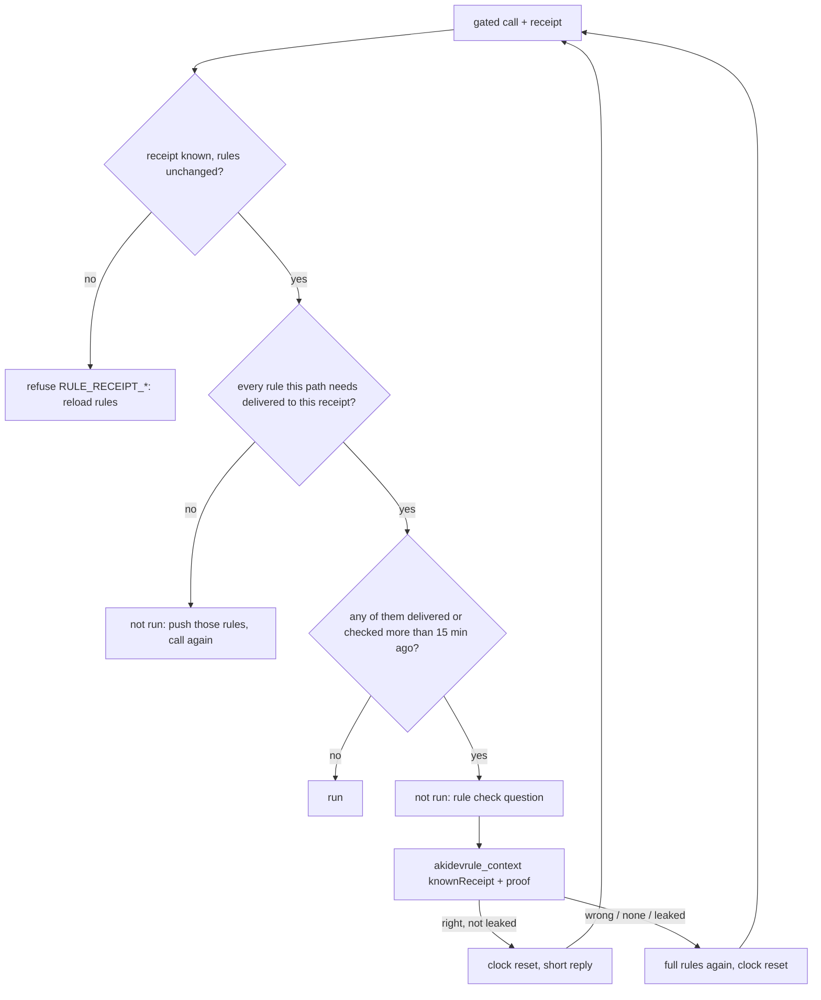

# Plan — rule presence check: a receipt that survives a compaction no longer passes

Status: proposed, not started. Owner gates: D1 (this repo, shared core: every seat restarts AkiMCP) and D2 (AkiDevRule route map, § Dependency). Successor of [`done/rule-receipt-gate.md`](done/rule-receipt-gate.md) § Limits ("after a compaction it still passes") and of D23 in [`akimcp-tool-refactor.md`](akimcp-tool-refactor.md).

## Problem

An AI whose context was compacted keeps writing without the rules, and the gate lets it.

| # | Fact | Source |
|---|---|---|
| F1 | A receipt proves the rules were issued, not that they are still in context | `scripts/rule-gate.js:1`; `done/rule-receipt-gate.md` § Limits |
| F2 | A compaction summary keeps the receipt string, so the next write passes with the rule text gone | observed in a Notion seat, 2026-10-11 |
| F3 | No per-chat identity exists on the wire: Notion opens a new MCP session per call | `done/rule-receipt-gate.md` § Rejected |
| F4 | The receipt is a hash of the rule content, so every chat with the same rules holds the same receipt: the server cannot tell which chat received what | `rule-gate.js` `issued` map |
| F5 | A gated call pushes only `CLAUDE.md`/`CLAUDE.local.md`/`AGENTS.md`/`GEMINI.md`; the rules routed by artifact type (code → `RULE-coding.md` + `RULE-pattern-core.md`, `.md` → `RULE-docs.md`, test → `RULE-test.md`, …) are never pushed or checked | `scripts/project-rules.js` `PROJECT_FILES` |
| F6 | Nothing outside the model marks a compaction: the Notion transcript has no compaction marker and no token count | aiobox `docs/ref/fact-notion-ai-context-window.md` |
| F7 | Text does not make a model read rules (18% organic second hop on Claude Code); a deny at the write does | AkiDevRule `docs/research/rule-delivery-second-hop-sep29.md` |
| F8 | Sizes: `akidevrule_context` output ≈ 56 KB; `RULE-coding.md` + `RULE-pattern-core.md` 20.6 KB; `RULE-docs.md` 19.4 KB; `RULE-agent-behavior.md` 24.2 KB | `wc -c`, 2026-10-11 |
| F9 | A changed tool definition makes Claude ask "Always allow" again for that tool in every window and needs a reconnect | `akimcp-tool-refactor.md` P3; CHANGELOG 3.0.0 |
| F10 | The Claude Code gate knows exactly when a compaction happened: its transcript scan resets at every `system` line with `subtype: compact_boundary`. Its precision rests on that marker, which no AkiMCP client gives (F6) | AkiDevRule `claude/hooks/aki-route-guard.mjs` `scanTranscript` |
| F11 | Even with the marker and a deny, a routed edit after a compaction was preceded by a whole re-read 482/521 (93%) on Opus 5.5 and 411/530 (78%) on Sonnet 5.5; the first reply after a compaction carried a `[RULES]` line 8/18 and 9/15, despite the compaction notice | AkiDevRule `scripts/second_hop_audit.py 2026-10-08 --by-model`, run 2026-10-20 (gate shipped 2026-10-08, `b0289c8`) |
| F12 | The Claude Code gate matches only `Edit\|MultiEdit\|Write\|NotebookEdit`: a file written through Bash (`sed -i`, heredoc, a script), which the auto-mode harness text invites, is never gated. It also opens after 3 denials per rule per segment, and passes any path outside the project or under an ungated prefix | `~/.claude/settings.json` PreToolUse matchers; `aki-route-guard.mjs` `MAX_DENIALS_PER_RULE`, `isUngatedPath` |
| F13 | What both sides measure is the mechanism (a read happened, a check passed), never the outcome (fewer rule breaches after a compaction). No breach rate before vs after the gate exists for either | F11 columns; this plan's U1–U4 |

## Outcome

Every 15 minutes per chat, the first gated call asks one short question that only an AI holding the rule text can answer. Right: it runs. Wrong, or "none": the rule text is pushed again, then it runs. A rule the path needs and the chat never received is pushed before the call runs.

## Decided

| # | Decision | Why |
|---|---|---|
| D1 | **One receipt per issuance.** `akidevrule_context` returns `sha256:` + sha256(content receipt + random nonce); the entry stores the content receipt. `STALE` = the assembler's content receipt differs from the stored one | A per-chat key with no wire identity (F3, F4). The format stays `sha256:<64 hex>`, so the `knownReceipt` regex and every gated schema stay as they are (F9) |
| D2 | **A delivery ledger per receipt, in memory:** rule file → {sha256, time delivered or checked}. Filled by `akidevrule_context` (its sources), by every push (D3) and by every passed check (D5) | The clock needs to know what went to which chat and when. Memory only, as `done/rule-receipt-gate.md` D4: a restart forgets it and the next write reloads |
| D3 | **The `extraFiles` chain goes.** A project or routed rule file is pushed into the result once (32 KiB cap, `SHOWN_MS` parallel rule unchanged) and recorded in the ledger; the receipt does not change. A pushed file whose bytes change later counts as not delivered and is pushed again, without making the receipt `STALE` | The AI keeps one receipt for the whole chat until the core rules change; today every new repo hands out a new receipt to switch to |
| D4 | **Rules a path needs** = the receipt's core sources + project files found by `rulesFor` (today) + route files from AkiDevRule's route map (§ Dependency) for the path relative to its project root (nearest ancestor holding `.git`, else the AkiMCP root). A path the map marks ungated (`/.aki/`, `/tmp/`, `scratchpad/`) adds no route file. No map installed → core + project files only | Same mapping as the Claude Code gate, one source (F5) |
| D5 | **The check.** `CHECK_MS` = 15 min. When a needed file was delivered or checked longer ago, the call is not run (no error, no `RULE_*` code) and returns: `Rule check: call aki__akidevrule_context with knownReceipt=<receipt> and proof="<the 8 words that follow «<anchor>» in <file>>"; if <file> is not in your context, pass proof="none". Then call this tool again.` Anchor: 5 consecutive words, unique in the file, at a random offset of a random prose line of ≥ 16 words in one of the overdue files; the expected answer is the next 8 words. One pending check per receipt; parallel calls within `SHOWN_MS` get the same one | Proves presence instead of pushing blind: about 100 tokens per check against 25k+ per blind push (F8), which would itself hasten the next compaction. A summary cannot hold the answer: the anchor is drawn after it was written |
| D6 | **`proof` is a new optional argument of `akidevrule_context` only.** Right = at least 6 of the 8 words match position by position after normalising (lowercase, markup and punctuation stripped, whitespace collapsed) → every overdue file of that receipt is marked checked now; the reply is short (`checked`, no corpus). Wrong, `none` or leaked (D7) → the reply is the full output, as a load without `knownReceipt`, plus the overdue project/route files (same cap), all marked delivered now; the receipt stays the same | One tool definition changes, and a read-only one, instead of ~30 gated ones (F9). The failing path reuses the existing load. The 6-of-8 margin absorbs a slip by an AI that does hold the text |
| D7 | **A leaked anchor voids the proof.** While a check is pending, every read-tool result is scanned for the anchor followed by the expected words; a hit from a partial read (`search_content`, `head`/`tail`, a slice) marks the check leaked. A full `read_text_file` of the file is not a leak | The cheapest dishonest path (grep the anchor) must not pass. `proof="none"` costs one call, grep costs two, so the honest path is also the cheaper one |
| D8 | **`knownReceipt` without `proof`** answers `unchanged` as today and never resets the clock | Calling the tool must not count as holding the rules |
| D9 | **Old schema, no way to pass `proof`:** the check text also says "or call aki__akidevrule_context without knownReceipt" → a new receipt with the full rules → the call runs | No deadlock for a client that has not reconnected; worst case equals a blind push |
| D10 | **Each check is logged** in the call log (`akimcp-tool-refactor.md` D9): outcome `pass` / `fail` / `none` / `leaked` / `reload`, file, receipt prefix | The reopen triggers below need the numbers |

## Cases

| Case | Behaviour |
|---|---|
| New chat, no receipt | `RULE_RECEIPT_MISSING` (unchanged) |
| Working, all needed rules checked within 15 min | runs, no extra cost |
| 15 min passed, rules still in context | one check, right answer, runs (+1 call) |
| Compacted, summary kept the receipt | within 15 min one check; the AI cannot answer → full rules pushed → runs (+2 calls) |
| First edit of a new artifact type in the chat (code, then `.md`) | that route file pushed, then runs |
| Parallel calls at the same moment | one push or one check for all of them (`SHOWN_MS`) |
| A core rule file edited | `RULE_RECEIPT_STALE` (unchanged) |
| A pushed project or route file edited | pushed again on the next call that needs it |
| AkiMCP restarted | `RULE_RECEIPT_UNKNOWN` → reload (unchanged) |
| AI guesses the words | wrong → full rules pushed |
| AI greps the anchor | leaked → full rules pushed |
| Two chats on the same rules | separate receipts, separate ledgers |
| A receipt copied into another chat (handoff letter) | both share one ledger; each still meets a check within 15 min |
| Rule file over the 32 KiB cap | named with path + sha and "read it"; a later check covers it |
| Path with no rule files, `/tmp`, `~/.aki/` | core only |

## Rejected

- **Push the full rules every 15 min.** Simplest, cannot be cheated, keeps the rules recent in context; but 25k+ tokens per push (F8) per active chat fills the window faster and brings the next compaction closer. The chosen design costs the same in its worst case (every check failed) and ~100 tokens in the usual one.
- **Keep the core rules in each AI's own instructions** (Notion workspace or agent instructions, Claude/ChatGPT custom instructions). Never compacted, but: one copy per account across a large pool drifts at every rule change; ChatGPT caps custom instructions at 1500 characters; and a resident rule is still not a read one (F7: Claude Code keeps the core resident and needs the route gate anyway). It would not remove this gate.
- **Detect the compaction from the transcript.** The transcript has no marker (F6), and reading it would make AkiMCP depend on AIObox (`CLAUDE.md` § Stable core).
- **Bind to the MCP session.** Rejected before (F3).
- **`proof` on every gated tool.** Saves one call per check but changes ~30 tool definitions: every Claude window asks "Always allow" again (F9).
- **Proof packed inside the `receipt` string.** No schema change, but a compound string is easy to get wrong and hard to read in a log.
- **A copy of the route map inside AkiMCP.** A second copy of the Claude Code gate's map drifts; the audit script's copy already has (§ Dependency).

## The Claude Code gate is a reference, not a proof

D4 borrows the Claude Code gate's path → rule mapping, and only that. Its behaviour is not a standard this plan can inherit as "known to work":

- **It solves an easier problem.** On Claude Code only a compaction evicts content, and the harness marks it (F10), so "read since the last boundary" equals "in context". AkiMCP has no marker (F6) and no knowledge of what else a client evicts, so the 15-minute check (D5) is a substitute with no Claude Code counterpart to copy or to compare against.
- **Its deny leaks 7–22% of routed edits** (F11). The causes are visible: Bash writes are never gated, 3 denials open it, ungated paths pass (F12). The AkiMCP twin of the Bash hole is `run_cmd`: it acts, so it is gated, but it has no path, so D4 adds no route file and a file written through it skips the route check. Accepted as a limit, not closed: parsing a shell command for write targets is the fragile path the Claude Code gate also declined.
- **Text after a compaction does not work** (F11: about half the first replies carried the receipt the notice asked for). D5 asks a question instead of telling, which is the right side of F7; a design that leans on a "your rules may be gone" message is rejected by this evidence, not by taste.
- **Its success numbers are mechanism numbers** (F13). That a forced read happens says nothing about whether the rules were then applied. This plan's U1–U4 have the same blind spot, hence U5.

Consequence for the build: nothing here may be justified by "Claude Code does it"; every threshold (`CHECK_MS`, 6 of 8, the 32 KiB cap) is a guess until U1–U5 say otherwise, and the live test (step 6) records the Claude Code baseline (F11) beside AkiMCP's own numbers instead of assuming parity.

## Limits

- No signal marks a compaction (F6): an AI compacted right after a check writes without the rules for up to 15 minutes.
- The gate makes the rules present, not applied. Breaking a rule that is in context is out of reach of any tool check, except a mechanical lint at the write.
- Read-only calls and plain replies pass no gate; meaning-only routes (`think`, `proportion`, `biz`, `ux`, audits) stay model-dependent, as on Claude Code.
- The gate stops forgetting, not a deliberate forger (unchanged from `done/rule-receipt-gate.md`).

## To measure after shipping (reopen triggers)

- U1 · wrong answers while the rules are in context: reopen if > 10% of checks fail in chats with no compaction in between. Seen once in the issuing Notion seat: the 8 words after "Conclusion first" in `RULE-agent-behavior.md` came back verbatim.
- U2 · leaks: reopen if `leaked` > 5% of checks; then push blind for that receipt.
- U3 · the 15 min gap: reopen if violations right after a compaction are traced to the gap; `CHECK_MS` is one constant.
- U4 · a client that does not pick up `proof`: `reload` outcomes far above `pass` + `fail`.
- U5 · outcome, not mechanism (F13): sample writes made within 15 min after a failed check or a `reload` and count rule breaches a lint can see (`scythe.py` `[WRAP]`/`[YAP]`) against a sample from chats that passed; reopen the whole design if the two rates do not differ.

## Dependency — AkiDevRule route map (D2, owner gate)

In progress in AkiDevRule (its plan `docs/plan/route-map-json.md`; on 2026-10-20 still uncommitted there): `payload/route-map.json` exists, is deployed to `~/.aki/akidevrule/route-map.json`, and both the hook and `scripts/second_hop_audit.py` read it, which ends the drifted hand copy. JSON, never executable code: AkiMCP must not run code from the rules directory. AkiMCP works without it (D4): it then checks the core and project files only.

What stays code is the interpreter of the map's fields (`ext`, `name`, `nameRe`, `dirRe`, `dirSkipExt`, `projectHas`, `ungated.segments/prefixes/dirs`), today `routesFor` and `isUngatedPath` in the hook. AkiMCP needs its own, a second interpreter of one data file: step 3 keeps it to those fields, refuses a map with a field it does not know (falls back to core + project files, logged) rather than guessing, and its test feeds the deployed map the same paths the hook is tested on.

## Steps

- [ ] 0. AkiDevRule route map (its own plan `route-map-json.md`, in progress there; may land before or after 1–5).
- [ ] 1. `scripts/rule-gate.js`: per-issuance receipt entry, ledger (D2), `extraFiles` chain removed (D3), freshness and check (D5), leak scan in `withRules` (D7), log fields (D10); comment lines 1–3 rewritten.
- [ ] 2. `scripts/rule-context-mcp.js`: issue the per-issuance receipt (D1), `proof` argument and its two replies (D6), `knownReceipt` never resets the clock (D8); `RECEIPT_STEP`, description and server instructions name the check once.
- [ ] 3. `scripts/project-rules.js`: read the route map, project root by `.git`, ungated paths (D4); no map → today's behaviour.
- [ ] 4. `test/rule-gate.test.js` (clock via `setNow`): two issuances of the same rules get different receipts; a push records and does not change the receipt; before 15 min runs; after 15 min not run with a check; right proof → runs; 6 of 8 → runs; wrong / `none` → full rules then runs; leak by `search_content` → full rules; full read → no leak; `knownReceipt` alone does not reset; parallel calls share one check; edited pushed file → pushed again; edited core file → `STALE`; route map absent → core + project only; `/tmp` → core only. `test/tool-surface.test.js` budget for `proof`.
- [ ] 5. Docs: `docs/feat/tools.md` § Rule receipt gate; CHANGELOG `[Unreleased]` (restart AkiMCP; reconnect for the `akidevrule_context` definition, bundled per `akimcp-tool-refactor.md` P3); this plan to `done/` with the live record.
- [ ] 6. Live on the test seat (P14·W8): load, write, wait past 15 min, check passes; force a reload-less chat to answer `none`, rules pushed; grep the anchor, leak caught; two chats, separate ledgers. The live record sets these numbers beside the Claude Code baseline (F11).
